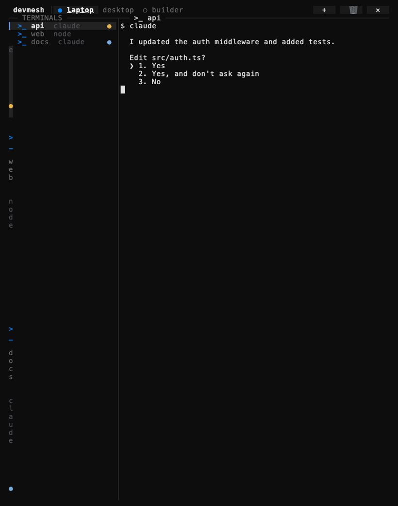

# devmesh


devmesh is a self-hosted control plane for your terminals across machines: a WireGuard
network with a reverse-SSH fallback, joined with one line on Linux, macOS or Android
(Termux), and driven from a live TUI panel. No accounts and no third-party cloud: the hub
is a small server you own.



## How it works

```
  devices (control)             hub (your VPS)                machines (tmux)
  Mac · tablet · phone                                        Linux · macOS
  ┌──────────────┐   A: WireGuard (udp/51820)   ┌─────────┐   ┌─────────────┐
  │     dm       │ ═══════════════════════════> │         │ ══> │ tmux sessions│
  │  live panel  │                              │   hub   │   └─────────────┘
  │              │   B: ssh (tcp/2222) ───────> │         │ <── reverse tunnel
  └──────────────┘      via the hub             └─────────┘     opened by each machine
```

- **Path A, WireGuard:** devices reach machines directly over the private network.
- **Path B, reverse SSH:** each machine keeps a tunnel open to the hub. When UDP is
  blocked, `dm` goes through the hub over SSH. It tries A first and falls back to B by itself.
- Terminals live in tmux on each machine, so they survive disconnects.

## Requirements

| Piece | Needs |
|---|---|
| Hub | Ubuntu 20.04+ or Debian 11+ (native install), or any Linux with Docker. 1 vCPU, 512 MB. UDP 51820 and TCP 2222 open, plus TCP 443 (domain mode) or TCP 8443 (IP mode). A domain also needs port 80 for the Let's Encrypt challenge |
| Machines | Linux with systemd, or macOS 13+ with Homebrew |
| Phone / tablet | Android with Termux from F-Droid |
| Panel | tmux 3.2 or newer for the workspace. The list is `dm-tui`, a prebuilt binary that ships with the client (macOS, Linux, Termux); without it, with an older tmux, or with `DM_UI=fzf`, `dm` uses the fzf panel (fzf 0.66 or newer; older fzf: classic menu) |

## Install the hub

Guided installer (Ubuntu/Debian, as root). It resolves the latest release, verifies it
against `SHA256SUMS`, asks for a domain or an IP, an email (domain only, for Let's Encrypt)
and an optional [age](https://age-encryption.org) public key for encrypted backups:

```sh
curl -fsSL https://raw.githubusercontent.com/chsotelo/devmesh/main/install.sh | sudo bash
```

Non-interactive: set `HUB_HOST` (and `ACME_EMAIL` for a domain, `BACKUP_RECIPIENT` optional).

- **Domain mode** (`hub.example.com`): Let's Encrypt certificate on 443.
- **IP mode** (`203.0.113.10`): self-signed certificate on its own port, 8443. The join
  line carries the certificate pin (`--pinnedpubkey 'sha256//…' -k`), so it is still verified.

From a checkout, over SSH (idempotent; also re-applies an existing hub):

```sh
make hub HOST=root@203.0.113.10 HUB_HOST=hub.example.com ACME_EMAIL=you@example.com
```

With Docker (host networking; see [docker/hub/README.md](docker/hub/README.md) for limits,
such as fail2ban and `ip_forward` living on the host):

```sh
HUB_HOST=203.0.113.10 docker compose -f docker/hub/compose.yml up -d --build
```

Backups and moving the hub: `make backup-pull` fetches the latest encrypted backup;
`make restore HOST=root@<new-ip> BACKUP=backups/<file>.tar.gz.age HUB_HOST=<host>` rebuilds
on a new VPS. In IP mode, run `dm repoint <new-ip>` once on each device afterwards.

## Join a device

On a device that is already joined (the first one: on the hub, `devmesh invite <name>`):

```sh
dm add tablet          # prints and copies one JOIN line, plus a QR code
```

Paste the `JOIN:` line on the new device. It works for Linux, macOS and Termux, is valid
once and expires after 15 minutes. Linux machines ask for `sudo`; Termux asks you to
import a WireGuard config into the WireGuard app.

## Use the panel

`dm` opens the terminal panel of VS Code, on tmux: **a tab per machine on top (the device
selector), the machine's terminals as a list on the left, the real terminal on the right.**

```
 devmesh │ ● laptop  desktop  ○ builder                          + │ 🗑 │ ✕
▎ >_ api              ● │ $ claude
  >_ web                │   I updated the auth middleware and added tests.
  >_ docs             ● │   Edit src/auth.ts?
```

- Top bar: the active machine is bright with its color dot, the rest gray, an off machine shows
  `○`. Click or tap a tab to switch.
- Left list: one row per terminal with a dot for the agent in it (yellow waiting, blue working,
  green idle). Click or `enter` shows it on the right; arrows or `j`/`k` move; it refreshes
  every 3 s.
- Buttons: `+` new terminal (asks for a name), `🗑` delete the terminal on screen (asks first),
  `✕` leave (everything keeps running; `dm` re-attaches to the same place). Keys: `Ctrl+a +`,
  `Ctrl+a x`, `Ctrl+a d`.
- Under 70 columns (phone) the list is hidden and the terminal fills the screen; `☰` / `Ctrl+a s`
  swaps to the list and back.
- `DM_UI=cards dm` opens the previous card panel (below), `DM_UI=fzf dm` the fzf one; both are
  also used automatically when there is no `dm-tui` binary or tmux is older than 3.2.
- For screenshots and tests, `DM_DEMO=1` makes each terminal pane print the screen the ssh stub
  returns instead of connecting (`docs/demo/run.sh`).

### Card panel (`DM_UI=cards`)

The first tab is the panel, each open terminal gets a tab.
The panel is an app-like screen made for touch: every machine is a section and every
terminal is a card with its agent state (working, waiting, idle), who is attached, the last
activity and a **live thumbnail of its screen**. The grid adapts to the screen: one column on
a phone, two on a portrait tablet, more on a wide screen, where a **detail pane** with a big
live view of the selected terminal appears from 140 columns. On a narrow screen, `enter` on a
card opens the same detail full screen. Cards refresh every 4 seconds and the thumbnails of
the cards in view every 3 seconds, without ever blocking the keyboard. Everything is
tappable: cards (tap to select, tap again to open), the top-bar buttons and the machine
buttons; the wheel scrolls.

```
 devmesh 0.8.1                 [new] [↻] [send] [web] [fetch] [devices]
 ● laptop  3 terminals                                           [new]
╭─────────────────────────────────╮ ╭────────────────────────────────╮
│ api                   ● waiting │ │ web                            │
│ claude · tablet             40s │ │ node · laptop               5m │
│ ── tablet ───────────────────── │ │ ────────────────────────────── │
│ I updated the auth middleware … │ │ $ npm run dev                  │
│ Edit src/auth.ts?               │ │ VITE v6 ready in 312 ms        │
╰─────────────────────────────────╯ ╰────────────────────────────────╯
 ○ desktop  offline                                             [wake]
                     enter open  n new  / filter  ? shortcuts  q quit
 tablet · 3 machines · 3 terminals · 1 waiting
```

| Key | Action |
|---|---|
| arrows · `h j k l` | move between cards and machines |
| `enter` | open the terminal (wide screen) or its detail (narrow); a machine opens its menu; an offline one is woken |
| `o` | open the selected terminal |
| `n` | new terminal: machine, then project, or type a name |
| `s` / `f` | send a file / fetch a file |
| `w` | preview a machine's dev server locally |
| `d` / `a` | list devices / add a device |
| `r` | refresh |
| `/` | filter the terminals |
| `esc` | go back one screen; on the home screen clear the filter, then quit |
| `?` | list the shortcuts |
| `q` · `ctrl+c` | quit the panel |
| `Ctrl+a p` / `Ctrl+a n` / `Ctrl+a d` | tmux workspace: panel tab / next tab / leave (everything keeps running) |

The panel (`dm-tui`) only draws: everything that touches a machine still goes through
`dm`. The panel is English by default. Spanish: `DM_LANG=es dm` (or a `LANG=es_*` locale).
`DM_UI=fzf dm` (or `DM_TUI=0 dm`) runs the fzf panel instead.

## Commands

| Command | What it does |
|---|---|
| `dm` | workspace: a tab per machine, its terminals on the left, the terminal on the right |
| `dm new [machine]` | new terminal, guided |
| `dm list` / `dm who` | every terminal on every machine, as a list / a table |
| `dm go [machine] [name]` | enter a terminal (default `main`) |
| `dm close` | close a terminal |
| `dm send [file]` / `dm fetch` | send a file to a machine / bring one back |
| `dm port [stop]` | preview a machine's dev server at `http://localhost:<port>` |
| `dm mesh` | what this Linux machine exposes on the mesh (only SSH, mosh and ping by default) |
| `dm add <name> [--lan L] [--watch-hub]` | join line for a new device |
| `dm devices` / `dm rm` | list / revoke devices |
| `dm wake [machine]` | Wake-on-LAN through a machine on the same LAN |
| `dm refresh` / `dm update` | pull device list and ssh config / update the client |
| `dm repoint <ip\|host>` | follow the hub to a new address (checks its host key) |
| `dm agent <state>` | for tool hooks: `working`, `waiting`, `idle`, `clear` |
| `dm vscode on\|off\|status` | machines: VS Code terminals start inside tmux, visible from every device |

Hub side (as root): `devmesh invite|remove|ls|check|gc|backup|restore|apply|dist`.

## How it compares

| | devmesh | Tailscale + tmux | Headscale / NetBird | Claude Code Remote Control | Moshi / Termius |
|---|---|---|---|---|---|
| What it is | hub + client scripts for terminals | managed VPN you pair with your own tmux | self-hosted VPN control servers | official feature to drive a Claude Code session remotely | SSH/mosh terminal apps |
| Self-hosted | yes, all of it | coordination is a vendor service | yes | no (Anthropic service) | the app is not; your SSH servers are |
| Network layer | WireGuard + SSH fallback | WireGuard (with relays) | WireGuard-based | not a network | your own network or VPN |
| Terminal listing, tabs, send/fetch | built in | you assemble them | not their scope | one session per instance, ends when the terminal closes | per-host sessions |
| Phone client | Termux (Android) | native apps | native apps | Claude apps | native apps (iOS/Android) |
| Maturity | young, small | established | established | official | established |

Pick the VPN products if you only need the network. devmesh covers the network and the
terminal workflow on top, at the cost of running a hub.

## Security model

With approvers, the hub is not trusted for access: authorized SSH keys, machine host keys and
client updates (`dm update`) are only accepted when an approver (one of your own devices)
signed them, and revocations are signed too. A compromised hub can cut the service and see
metadata, but cannot add a key, impersonate a machine or ship code, as long as devices run in
signed mode and joined before the compromise. Join lines are single-use, expire in 15 minutes,
and their second part is a secret that never reaches the server. Full threat model, residual
risks and exposed ports: [docs/SECURITY-MODEL.md](docs/SECURITY-MODEL.md). To report a
vulnerability, see [SECURITY.md](SECURITY.md).

## Develop

```sh
brew install bash bats-core shellcheck shfmt age   # macOS
make check             # shellcheck + shfmt + bats (stubs)
make integration       # real hub and machines in Docker (needs Docker, internet)
make tui              # build dm-tui for this machine into client/bin (needs Go)
make tui-all          # ...for macOS, Linux and Android/Termux (arm64 and amd64)
make tui-check        # go vet + gofmt + go tests of the Go panel
make demo              # re-record docs/demo.gif (needs vhs; builds dm-tui)
```

## More

User guide: [English](docs/en/GUIDE.md) · [Español](docs/es/GUIA.md) · Background:
[docs/history/DESIGN.md](docs/history/DESIGN.md) · [CONTRIBUTING.md](CONTRIBUTING.md) ·
[CHANGELOG.md](CHANGELOG.md)

## License

MIT, see [LICENSE](LICENSE).
